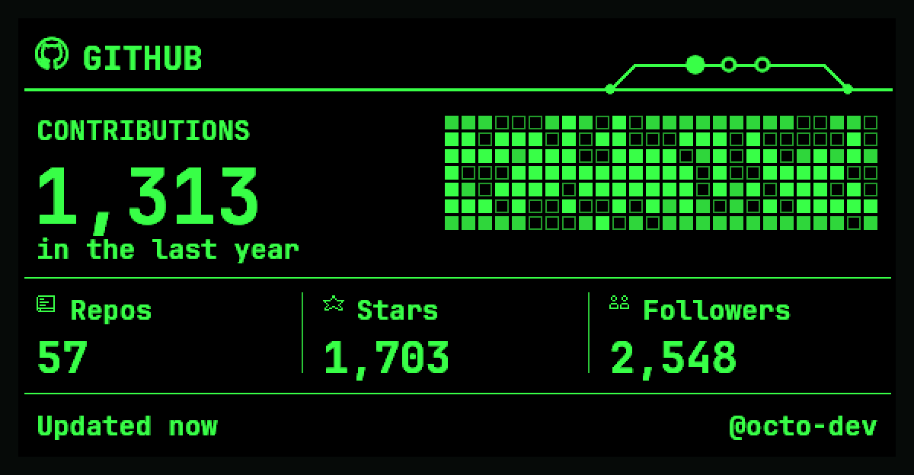
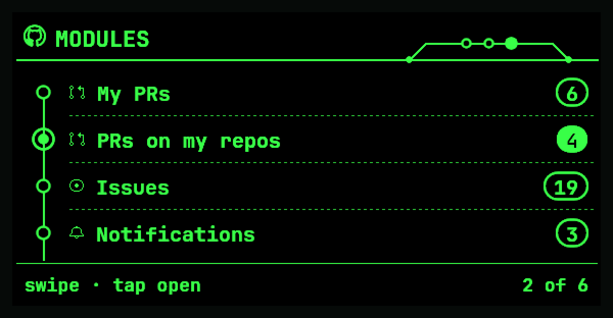
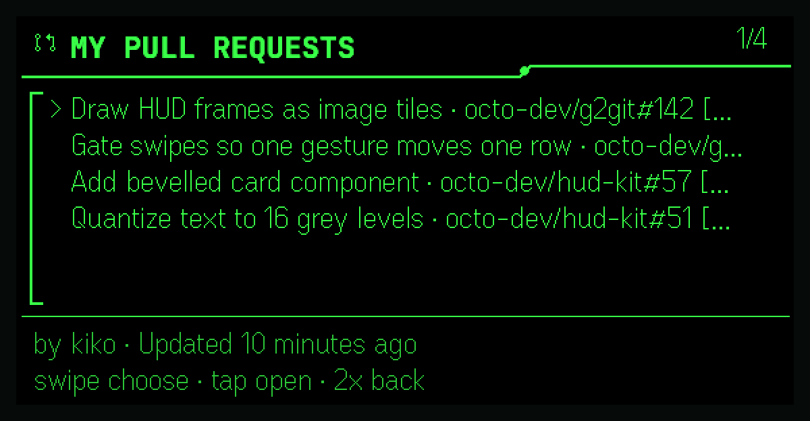
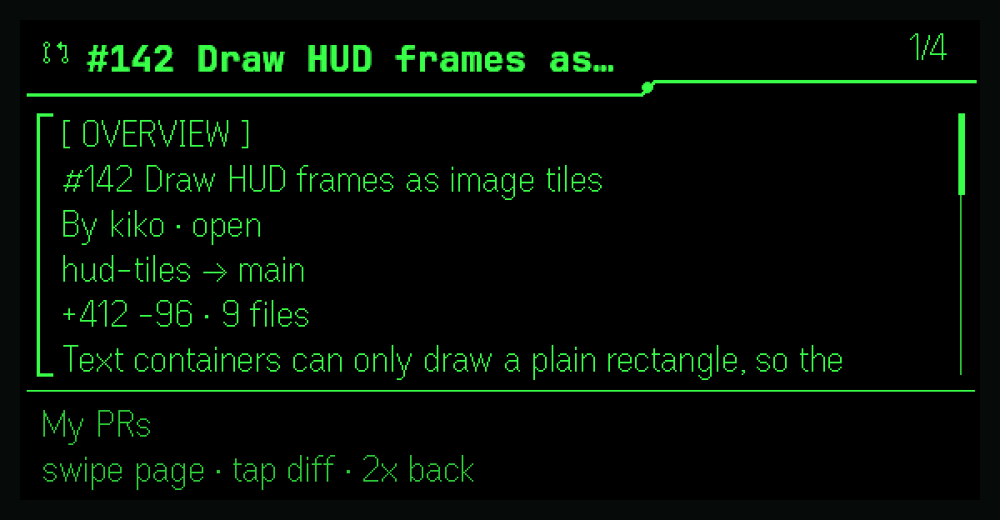
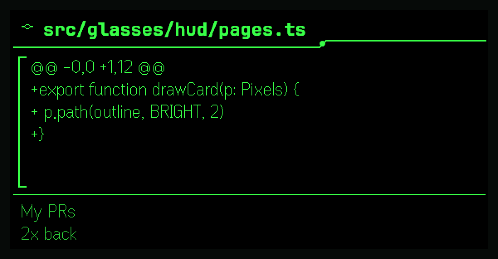
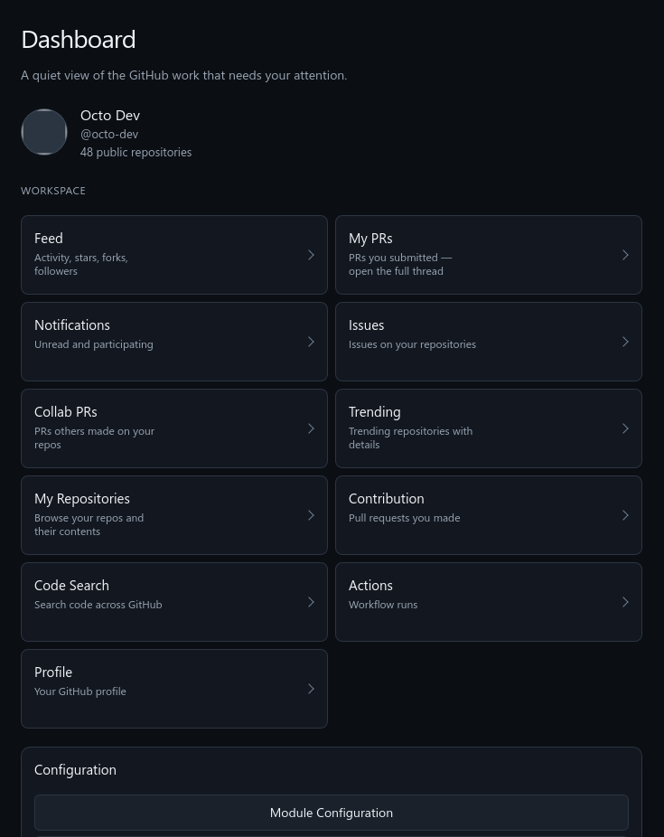

# GitGlass

GitHub on your face. GitGlass is a GitHub client for the Even Realities G2 smart
glasses: your contributions, pull requests, issues and notifications on the HUD,
driven from the temple touchpad or the R1 ring. The phone app handles sign-in
and settings.

<p align="center">
  
</p>

## Screens

| | |
|---|---|
|  |  |
| **Overview.** Contributions in the last year next to your contribution heatmap, plus repos, stars and followers. | **Pull requests.** How many of your PRs were merged, with a merged / open / closed bar. |
|  |  |
| **Modules.** Every module as a node on a git graph, with live counts. | **Lists.** Swipe to pick a row. The counter shows where you are. |
|  |  |
| **Details.** The whole PR thread: overview, comments, reviews, files, commits. | **Diffs.** Tap a PR to read the patch of its first changed file. |

The phone side holds the token, module toggles and a full dashboard:

<p align="center">
  
</p>

Screenshots are from the Even Hub simulator on sample data (`VITE_HUD_DEMO=1`).

## Modules

- **My PRs**: pull requests you opened, with the full thread
- **PRs on my repos**: open pull requests other people sent you
- **Issues**: open issues on your repositories
- **Notifications**: your unread GitHub inbox
- **Feed**: stars, forks, follows, pushes and releases around you
- **Trending**: repositories that picked up the most stars this week
- **My repos**: your repositories with stars, PRs, issues, languages and recent commits
- **Collab PRs**, **Actions**, **Profile**

Turn modules on or off from the phone. The dashboard graph and the hold menu follow.

## Controls

| Gesture | Dashboard | Lists | Details |
|---|---|---|---|
| Swipe | next / previous page, then module | move the cursor | next / previous page |
| Tap | open the selected module | open the item | open the diff (PRs) |
| Double tap | exit | back | back |
| Tap and hold | module menu | module menu | module menu |

## How the HUD is drawn

The G2 firmware can only draw text and plain rectangle borders, in one font at
one size. GitGlass draws everything else itself:

1. Each screen is drawn on a 576 x 288 canvas in the glass's 16 grey levels.
   Text on it uses JetBrains Mono Bold, and every pixel is snapped to one of
   those 16 levels so antialiased edges come out as real grey steps.
2. The canvas is cut into four 288 x 144 tiles, the largest image containers
   the glasses accept, and sent as PNGs. A tile is only resent when its pixels
   changed.
3. Text that changes on every swipe (list rows, the counter, the hint line) stays
   in firmware text containers on top of the tiles, so moving the cursor is
   instant.

The page is created once at launch. After that every screen change is a tile
send or an in-place text update, with no page rebuilds and no flicker.

## Install

GitGlass is in beta on Even Hub (`com.arcxlo.githubg2`). If you're a tester,
open the Even Realities app, go to **Me → Beta tester** and install
**GitHub G2**.

To connect, create a GitHub personal access token and paste it on the phone
screen. A classic token with `repo`, `read:user` and `notifications` covers
everything. Fine-grained tokens work too, but GitHub doesn't let them read
notifications. The token stays in the Even app's storage on your phone and is
only sent to `api.github.com`.

## Develop

```bash
npm install
npm run dev                         # phone page on http://localhost:5173
npm run sim                         # Even Hub simulator, automation on :9898
VITE_HUD_DEMO=1 npm run dev         # sample data, no token needed
```

The sample-data client only loads in dev builds and never ships.

Package and upload:

```bash
npm run build
npm run pack                        # github-g2.ehpk, stamped with the installed SDK version
evenhub upload github-g2.ehpk -m "what changed"
```

Bump `version` in both `package.json` and `app.json` before each upload.

## Layout

```
src/
  main.ts              wires the phone app, the store and the glasses
  even.ts              Even Hub bridge: the fixed page, input events, write queue
  glasses/
    app.ts             screens, navigation and data for the glasses
    navigation.ts      screen stack
    hud/
      canvas.ts        16-level pixel canvas, tiles, PNG encoding
      pages.ts         dashboard, graph and Box layouts
      display.ts       paints a view, resends only changed tiles
      art.ts           GitHub mark and section icons
      text.ts          fits firmware text with @evenrealities/pretext
  phone/               the phone companion views
  github/              REST and GraphQL client and services
  state/store.ts       state shared by phone and glasses, kept in Even storage
  dev/demo-client.ts   sample data for the simulator (dev only)
```

## Credits

- [JetBrains Mono](https://github.com/JetBrains/JetBrainsMono), SIL Open Font
  License 1.1 (`src/glasses/hud/fonts/OFL.txt`). An ASCII subset is bundled.
- The GitHub mark path comes from [Simple Icons](https://simpleicons.org) (CC0).
  GitHub and the Octocat are trademarks of GitHub, Inc. GitGlass is not affiliated
  with GitHub or Even Realities.
- Built with the [Even Hub SDK](https://hub.evenrealities.com/docs).
